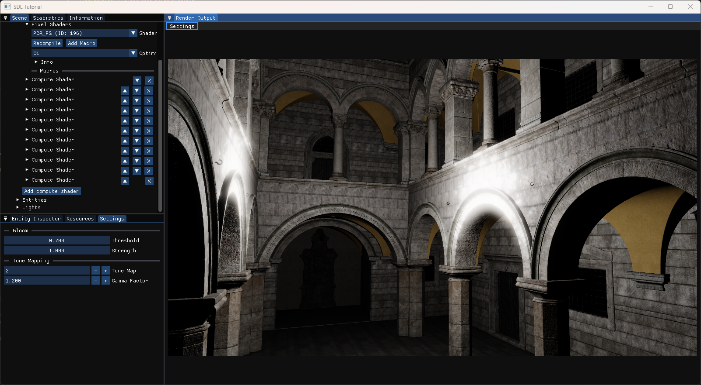

# PipeEngine

A real-time rendering engine written in C++20 on top of Direct3D 11, built as a sandbox for experimenting with shader pipelines. Pipelines are assembled at runtime from the UI: vertex, pixel and compute shaders can be added, removed and reordered, and shader resources are discovered automatically through shader reflection, so post-processing chains can be built and tweaked without recompiling the engine.

## Features

- **Runtime-editable pipelines**: add, remove and reorder compute shader passes from the UI
- **Shader reflection**: bound resources are detected from the compiled shaders and exposed in the UI
- **Compiled shader cache** with hot recompilation
- **PBR** rendering with glTF/GLB and OBJ model loading (via Assimp)
- **Post effects**: bloom, Gaussian blur, tone mapping with gamma control, depth of field, Sobel edge detection and more
- **Profiling and benchmarking**: CPU/GPU timings, statistics and Tracy integration
- **Scene system** with a range of demo scenes (Sponza, bloom, tone mapping, stress test, collision, …)

## Requirements

- Windows 10/11
- Visual Studio 2022 (toolset v143) with the *Desktop development with C++* workload
- A Direct3D 11-capable GPU

Third-party dependencies (SDL2, Assimp, Dear ImGui, stb, Tracy) are included in `Project/dep`.

## Getting started

1. Clone the repository.
2. Download the Sponza scene (see below) and place the `.glb` files in `Project/res/ObjectFiles/`.
3. Open `Project.sln` in Visual Studio, select the `x64` platform and build/run.

Hold **LBM** and press **WASD** to for camera control.

## Sponza scene

The Sponza model files are too large to store in the repository, so download them separately:

**[Download Sponza (Intel GPU Research Samples)](https://www.intel.com/content/www/us/en/developer/topic-technology/graphics-research/samples.html)**

The engine expects the following files in `Project/res/ObjectFiles/`:

- `sponza_1K_noDecals.glb`
- `sponza_4K_noDecals.glb` (used by the benchmark scene)

## License

This project is licensed under the MIT License. See [LICENSE](LICENSE) for details.
